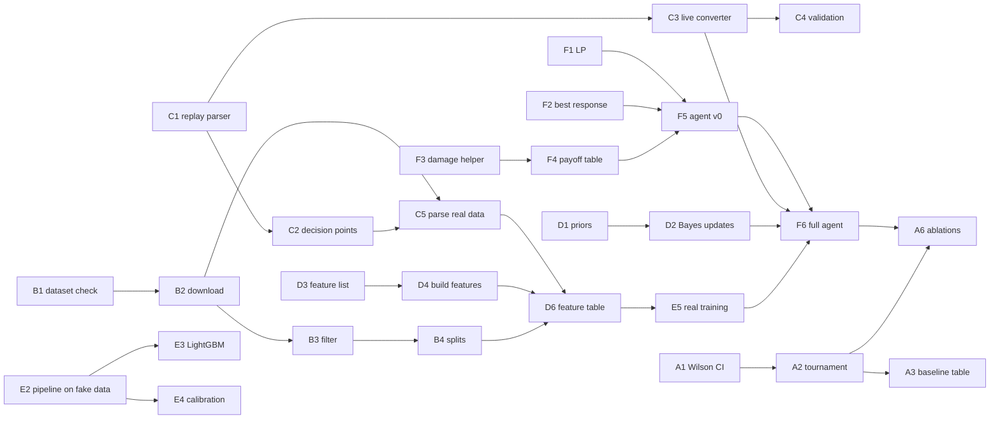

# Tasks

The to-do list for version 1, in priority order. **If you want to start right now, pick
any task marked 🟢 in your role** (or in any unclaimed role). Every 🟢 task can start today
with no one else's work: it uses fake inputs or local games.

- 🟢 **Start now:** no dependencies.
- 🟡 **Soon:** depends on a 🟢 task that should land within a few days.
- 🔴 **Later:** needs several pieces in place.

Sizes are rough effort for one person: **S** = a few hours, **M** = 1–2 days, **L** = 3+ days.

## How to pick up a task

1. Find the task's GitHub issue (same ID in the title, e.g. `[C1]`): every task has one,
   labelled by role and by `start now` / `soon` / `later`.
   [All start-now issues](https://github.com/RaghavSinghal15/Pokemon-Battle-Agent-ML-3-1/issues?q=is%3Aopen+label%3A%22start+now%22).
   **Assign yourself** and say so in the group so two people don't do the same thing.
2. Branch: `<role>/<task-id>-short-name`, e.g. `c/c1-replay-parser`.
3. Read your role's section in [docs/02-roles.md](docs/02-roles.md) and anything the task
   links to. If an AI assistant helps you, it reads [AGENTS.md](AGENTS.md) automatically.
4. Open a pull request when "done when" is true. Reviewer: see the table in
   [CONTRIBUTING.md](CONTRIBUTING.md). Raghav also reviews anything game-related.

## Who does what (until tonight)

Roles get finalised tonight. Until then, this is a suggestion so people can start:

| Person | Suggested role | First task |
|---|---|---|
| Raghav | E (opponent model) + domain reviewer + works across | **B1** (dataset check, 15 min), then E1, E2 |
| Yash | D (beliefs and features): needs someone who has played | D1, D3 |
| Devam | F (decision engine and agent) | F1, F2 |
| Krrish, Vyom, Rishi | A, B and C: one each, your choice | A1 / B2 (after B1) / C1 |

C (parser) is the most important of the three: everything downstream trusts it. Whoever takes
it should be careful and like debugging. A and B need zero Pokémon knowledge.

## Before anything else (everyone)

| ID | Task | Who | Size | Done when |
|---|---|---|---|---|
| S1 🟢 | Set up: clone, install, start the local server ([docs/07-setup.md](docs/07-setup.md)) | Everyone | S | `python scripts/check_setup.py` and `python scripts/play_baselines.py --games 20` both work; output posted in the group |
| S2 🟢 | Read [01](docs/01-project-explained.md), [02](docs/02-roles.md), [03](docs/03-pokemon-primer.md) and [08](docs/08-foundation-checks.md) in `docs/`; play 10–15 Random Battles on <https://play.pokemonshowdown.com> | Everyone | S | You can explain in two sentences what your role's module does |
| S3 🟢 | Claim a role | Everyone | — | Your name is in the table in [docs/02-roles.md](docs/02-roles.md) |
| X1 🟡 | Agree the three `interfaces.py` clarifications in [docs/08](docs/08-foundation-checks.md#proposed-interface-changes-check-6), then freeze the file | Owners of C, D, F + Raghav | S | Docstrings updated; any later change needs every affected owner's approval |
| X2 🟢 | Confirm the [evaluation plan](docs/09-evaluation-plan.md) | Team | S | Plan marked final in [docs/decisions.md](docs/decisions.md) |
| X3 🟢 | Ask the instructor about the deliverables, the viva format, deadlines, and whether specific algorithms must appear | Raghav | S | Answers written in [docs/decisions.md](docs/decisions.md) |

## What depends on what

Two moments matter most:

- **F5: our agent beats the random and max-power bots** using only the damage calculator.
  From then on we always have a working bot, and every later piece just makes it smarter.
- **F6: the full agent plays** with the parser, beliefs and opponent model plugged in
  (milestone M5). Once this works, the project is safe.

---

## A. Infrastructure and evaluation (no Pokémon knowledge)

| ID | Task | Depends on | Size | Done when |
|---|---|---|---|---|
| A1 🟢 | `eval/stats.py`: `win_rate_ci` with the Wilson score interval | — | S | Tests check known values (e.g. 50 wins in 100 games gives about 40.4% to 59.6%), 0 wins and all wins |
| A2 🟢 | `eval/tournament.py`: `run_matchup` plays N games between two players and saves wins, games, interval, commit hash, seed and date as JSON in `reports/results/` | A1 (soft) | M | A new `scripts/run_tournament.py --p1 heuristics --p2 random --games 100` writes a results file |
| A3 🟡 | Baseline table: random vs max power vs heuristics, 1,000 games each pair | A2 | S | `reports/results/baselines.md` with win rates and intervals |
| A4 🟢 | Help every teammate pass S1; add any Windows/Mac problems you hit to [docs/07-setup.md](docs/07-setup.md) | — | ongoing | All six setups work |
| A5 🟡 | Save the public log of every game our agent plays (reuse the spectator code in `scripts/spikes/collect_local_games.py`) | A2 | M | Tournament runs can save logs to `data/interim/agent_games/`, for C4 and the failure analysis |
| A6 🔴 | Ablation runner (the variants in [docs/09](docs/09-evaluation-plan.md#ablations-owner-a-with-f)) | F6, A2 | M | One command runs every variant and writes one table |

## B. Data pipeline (no Pokémon knowledge)

| ID | Task | Depends on | Size | Done when |
|---|---|---|---|---|
| B1 🟢 | **Run the dataset check** on a laptop: `python scripts/spikes/check_dataset.py` (on the `main` branch) | — | S | Output pasted in the group and added to check 1 in [docs/08](docs/08-foundation-checks.md). **This unblocks all real-data work: do it first** |
| B2 🟡 | `data/ingest.py`: `download_replays` streams the dataset, keeps `gen9randombattle`, saves Parquet. Sample mode (5,000 battles) for development | B1 | M | Sample Parquet exists locally; columns documented in `data/README.md` |
| B3 🟡 | `data/filter.py`: drop duplicates and unfinished games; keep games where both players are rated at least a threshold you choose from the rating distribution | B2 | M | Function + tests on a tiny hand-made table; counts at each step recorded |
| B4 🟡 | `data/splits.py`: split **by battle**, newest battles as test (e.g. 80/10/10 by date); write `data/splits.json` | B3 | S | Test that no battle id is in two splits and every test battle is newer than every train battle |
| B5 🟡 | `reports/data_report.md`: counts at each filtering step, rating and game-length distributions, and why each choice was made | B3, B4 | M | Report with plots, reviewed by C |

## C. Parser (medium Pokémon knowledge) · critical path

Start from checks 2–4 in [docs/08](docs/08-foundation-checks.md): we already know poke-env's
`Battle` parses logs correctly. You are building the real, tested version of
`scripts/spikes/replay_parse.py`.

| ID | Task | Depends on | Size | Done when |
|---|---|---|---|---|
| C1 🟢 | `parser/replay.py`: public log → one `PublicState` per turn, from each player's perspective. Includes the poke-env `Battle` → `PublicState` converter, with the HP rule, the species-at-first-reveal rule and the item rules from [docs/08](docs/08-foundation-checks.md) | — | L | Tests on a short hand-written log; parses the 400 local games from `collect_local_games.py` without errors. **Leakage test:** cutting the log right after `\|turn\|N` gives the same turn-N state |
| C2 🟡 | Labels: turn each player's turn into an `Action`, or "hidden" (port the rules in `scripts/spikes/label_visibility.py`), and emit `DecisionPoint`s | C1 | M | Tests per bucket (switch, move, can't move, fainted first, locked); matches true bot choices on local games |
| C3 🟡 | `parser/live.py`: `state_from_battle` re-parses the bot's own message stream (`battle._replay_data`) with C1's code | C1 | S | Returns the same `PublicState` type as C1 |
| C4 🟡 | Validation: on 1,000 local games, C1 on the spectator log and C3 on the live stream agree on every turn (port `scripts/spikes/compare_views.py`) | C1, C3 | M | A `pytest -m showdown` test, plus the result in [docs/08](docs/08-foundation-checks.md) |
| C5 🔴 | Run C1+C2 on the real data; report parse errors on human logs; write `data/processed/decision_points.parquet` | B2 (sample), C2 | M | Works on the 5,000-game sample, then the train split |

## D. Beliefs and features (high Pokémon knowledge)

| ID | Task | Depends on | Size | Done when |
|---|---|---|---|---|
| D1 🟢 | `beliefs/tracker.py`: `prior_belief`. Load `sets.json` from pokemon-showdown (`data/random-battles/gen9/`) and turn each species' roles into probabilities over roles, moves, abilities and tera types; items from the randbats stats or a sensible default | — | M | Tests on 3 species you can check by hand; probabilities sum to 1 |
| D2 🟡 | `update_belief`: Bayes' rule when a move, item, ability or tera type is revealed (a revealed move rules out roles that can't have it) | D1 | M | Hand-worked tests for 5 Pokémon; reviewed by Raghav |
| D3 🟢 | Design the feature list: `docs/features.md` with every feature and a one-sentence explanation (HP, speed comparison, type matchup, Pokémon remaining, hazards, boosts, tera used, ...) | — | M | 20–30 features, reviewed by Raghav (game sense) and E (model use) |
| D4 🟡 | `features/build.py`: `FEATURE_NAMES` and `build_features(state, beliefs)` on fake states (`make_state()` in `tests/test_interfaces.py`) | D3 | M | Each feature tested on at least one hand-made state; no feature uses the turn's action or result |
| D5 🟡 | Plot: belief entropy falling over a game as moves are revealed (on local games) | D2, C1 | S | Figure in `reports/figures/` |
| D6 🔴 | `data/processed/features.parquet` for every split | C5, D4, B4 | S | One row per decision point, with the split column |

## E. Opponent model (low Pokémon knowledge) · Raghav

| ID | Task | Depends on | Size | Done when |
|---|---|---|---|---|
| E1 🟢 | `models/labels.py`: `action_class` (move category from poke-env: Physical/Special → attack, Status → non-damaging; switch → switch) | — | S | Tests incl. U-turn (attack) and Swords Dance (non-damaging) |
| E2 🟢 | Full pipeline on a synthetic feature table: naive baseline, multinomial logistic regression, accuracy / macro-F1 / log loss / confusion matrix | — | M | One command trains and prints a report; only the input changes when real features arrive |
| E3 🟡 | LightGBM, tuned on validation; compared with logistic regression | E2 | M | Comparison table |
| E4 🟡 | `models/calibration.py`: Platt vs isotonic, reliability diagrams; decide how to handle the switch-label bias (check 4 in [docs/08](docs/08-foundation-checks.md)) | E2 | M | Plots + decision recorded |
| E5 🔴 | Train on real features, evaluate on test **once**, write `reports/results/opponent_model.md` | D6, E3, E4 | M | Both models beat the naive baseline on log loss (or we know why not) |

## F. Decision engine and agent (medium Pokémon knowledge)

| ID | Task | Depends on | Size | Done when |
|---|---|---|---|---|
| F1 🟢 | `decision/strategies.py`: `minimax_lp` with `scipy.optimize.linprog` | — | S | Tests: rock-paper-scissors gives 1/3 each; a game with a dominant row picks it |
| F2 🟢 | `best_response`: highest expected payoff against the predicted opponent probabilities | — | S | Tests on small hand-made tables |
| F3 🟢 | Damage helper: fill in the opponent's stats from species and level (85 EVs, 31 IVs, neutral nature, see check 5 in [docs/08](docs/08-foundation-checks.md)), then return expected damage as % of their HP for each of our moves | — | M | Works in live games on the local server; reuses `scripts/spikes/damage_calc_check.py` |
| F4 🟡 | `decision/payoff.py`: `build_payoff_table`, our options (moves, switches) × opponent's three action classes, one-turn payoff from F3. Write every simplification in [docs/decisions.md](docs/decisions.md) | F3 | L | Table for a live battle looks sensible to Raghav |
| F5 🟡 | Agent v0: `ExplainableAgent` uses F4 with flat opponent probabilities (no model yet) and best response | F2, F4 | M | **Beats random and max power** over 200 games each (A2 gives the intervals) |
| F6 🔴 | Full agent: C3 states, D2 beliefs, E5 model, both strategies; `agent/explain.py` writes one readable explanation per turn | F5, C3, D2, E5 | M | Plays 100 games with each strategy without errors; explanation log demo |

## After version 1 (M6, M7)

Evaluation (A3, A6 on the full agent), failure analysis of at least 10 lost games, the report
and a full mock viva. The extras pool (version 2) is in [docs/05-plan.md](docs/05-plan.md):
claim one only once your own version 1 tasks are done and reviewed.
