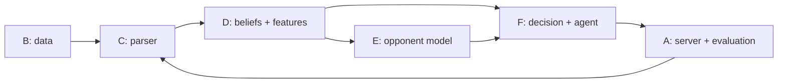

# Roles and division of work

Six roles, one owner each. The owner is responsible for their module working, being tested,
and being explainable in the viva. Anyone can help on any module through pull requests, but the
owner reviews and has the final say on it.

## Who owns what

| Role | Module(s) | Owner | Pokémon knowledge |
|---|---|---|---|
| A. Infrastructure and evaluation | `eval/`, `scripts/` | TBD | None |
| B. Data pipeline | `data/` | TBD | None |
| C. Parser | `parser/` | TBD | Medium |
| D. Beliefs and features | `beliefs/`, `features/` | TBD | High |
| E. Opponent model | `models/` | TBD | Low |
| F. Decision engine and agent | `decision/`, `agent/` | TBD | Medium |

Plus one extra duty, not a role: the **domain reviewer**, the most experienced player on the
team. They review anything game-related (parser semantics, features, payoff values) and answer
"is this how the game actually works?" questions. This is a few hours a week, done alongside
their own role.

### What the knowledge levels mean

- **None:** you never need to understand the game. Your inputs and outputs are files, numbers
  and win counts.
- **Low:** you need the vocabulary (what a switch is, what HP is) to interpret results, but no
  strategy. [03-pokemon-primer.md](03-pokemon-primer.md) is enough.
- **Medium:** you need to know what game events and mechanics *mean* (what happens when a
  Pokémon switches in, how speed decides who moves first), but not how to play well. The primer
  plus the official docs listed in your section is enough.
- **High:** you need game sense: which situations matter, what good players do and why. Best
  done by someone who has played, with the domain reviewer checking.

## How the roles depend on each other

The critical path is **B → C → D → E → F**. The parser (C) is the riskiest piece because
everything after it trusts its output. **Nobody waits for anybody**: every role starts on day 1
using hand-made fake inputs built from [`interfaces.py`](../src/pokeagent/interfaces.py) (see
`make_state()` in `tests/test_interfaces.py`), and switches to real inputs when they arrive.

---

## A. Infrastructure and evaluation

**In plain words:** you build the practice arena and the scoreboard. You make sure anyone can
run the local game server and make bots play each other, and you produce every win-rate number
in the final report.

**Version 1 deliverables**
- Setup instructions that work on every teammate's laptop (Windows included); help each person
  get `scripts/check_setup.py` passing.
- `eval/tournament.py`: run N games between any two players, save results with the commit hash
  and seed.
- `eval/stats.py`: win rate with a 95% confidence interval (Wilson interval).
- The baseline table: our agent vs random, max power and simple heuristics (500+ games each).
- Ablations: rerun the agent with one component switched off at a time (beliefs, opponent
  model, LP vs best response) and report the difference.
- Saving replays of games our agent plays, for role C's validation and the failure analysis.

**Pokémon knowledge: none.**

**Course and other concepts you will learn:** confidence intervals for a proportion, hypothesis
testing (is a 3-point difference real?), Python `asyncio` basics (poke-env is asynchronous),
experiment tracking.

**Start here:** `scripts/play_baselines.py` already works. Turn it into `run_matchup` and
produce a baseline-vs-baseline table with confidence intervals.

## B. Data pipeline

**In plain words:** you get the study material. Download recorded human games, throw out the
useless ones, store the rest efficiently, and split them so that nobody accidentally tests on
training data.

**Version 1 deliverables**
- `data/ingest.py`: stream the Hugging Face dataset, keep `gen9randombattle`, save Parquet.
  Support a small sample mode (e.g. 5,000 battles) for fast development.
- `data/filter.py`: deduplicate, keep finished games, keep battles where both players are rated
  above a threshold chosen from the data.
- `data/splits.py` and `data/splits.json`: split by battle (never by turn); the newest battles
  form the test set.
- `reports/data_report.md`: number of battles at each filtering step, rating distribution,
  game length distribution, and the reasons for each choice.

**Pokémon knowledge: none.**

**Course concepts:** data types and preprocessing, sampling, train/validation/test splits,
why splitting by group (battle) matters, exploratory data analysis.

**Start here:** load a few hundred rows of the dataset in a notebook and write down its
columns, size and how the format is identified.

## C. Parser

**In plain words:** you turn raw battle logs into clean snapshots of "what a spectator knew at
the start of each turn", plus what each player chose. You are the guardian against leakage.

**Version 1 deliverables**
- `parser/replay.py`: log → list of `DecisionPoint`s (two per turn).
- `parser/live.py`: a live poke-env battle → the same `PublicState`.
- Validation: for 1,000 games played on the local server, the replay parser and the live
  converter produce identical states every turn.
- The leakage test: cutting a log right after turn N leaves the turn-N state unchanged.
- `data/processed/decision_points.parquet` for the training data.

**Pokémon knowledge: medium.** You need to know what each log event means (switch, move,
damage, heal, status, boost, faint, terastallize, weather, hazards), but not strategy. Showdown
documents every event in `sim/SIM-PROTOCOL.md` in the pokemon-showdown repo; read it alongside
some real replays.

**Course concepts:** data leakage, train/test contamination, testing a pipeline against ground
truth.

**Start here:** try feeding a replay log into poke-env's own `Battle.parse_message` (it already
understands the protocol). If it tracks a spectator view correctly, you may only need to convert
its state into `PublicState` instead of writing a parser from scratch. Record what you find in
[decisions.md](decisions.md).

## D. Beliefs and features

**In plain words:** you play detective on the opponent's hidden team, and you decide how to
describe each situation as numbers. This is the role where game knowledge matters most.

**Version 1 deliverables**
- `beliefs/tracker.py`: prior probabilities over each species' roles, moves, items, abilities
  and tera types, and Bayesian updates as information is revealed.
- `features/build.py`: `FEATURE_NAMES` and `build_features`, plus `docs/features.md` with a
  one-sentence explanation of every feature.
- `data/processed/features.parquet` for the whole training set.
- A plot showing beliefs sharpening over a game (entropy falling as moves are revealed).

**Pokémon knowledge: high.** The math of the belief tracker is simple; knowing which features
capture what good players think about is not.

**Data you will use:** Showdown's `data/random-battles/gen9/sets.json` (roles and move pools
per species) and the randbats stats at <https://pkmn.github.io/randbats/> (how often each item,
move and tera type actually appears).

**Course concepts:** Bayes' rule, conditional probability, entropy, feature engineering,
one-hot encoding, scaling.

**Start here:** open `sets.json`, pick five Pokémon you know, and work out by hand how their
role probabilities change after each revealed move. Then turn that into code with tests.

## E. Opponent model

**In plain words:** you train the classifier that predicts what the opponent will do next, and
you make sure its probabilities can be trusted.

**Version 1 deliverables**
- `models/labels.py`: action → class (attack, non-damaging, switch).
- `models/opponent.py`: logistic regression and LightGBM, trained on the train split, tuned on
  validation.
- `models/calibration.py`: Platt scaling and isotonic calibration, compared.
- `reports/results/opponent_model.md`: accuracy, macro-F1, log loss, confusion matrix,
  reliability diagrams, feature importance, and the comparison with a naive baseline.

**Pokémon knowledge: low.** You consume features someone else defines. You need enough
vocabulary to interpret which features matter and to sanity-check predictions with the domain
reviewer.

**Course concepts:** multinomial logistic regression, gradient boosting (ensembles),
regularisation, evaluation metrics, class imbalance, calibration, log loss.

**Start here:** generate a synthetic feature table with a few columns and a 3-class label, and
build the full train → evaluate → calibrate → report pipeline on it. When real features arrive,
only the input changes.

## F. Decision engine and agent

**In plain words:** you build the part that actually chooses moves: the payoff grid, the two
strategies, and the bot that plays real games, plus its explanation log.

**Version 1 deliverables**
- `decision/payoff.py`: payoff table from poke-env's damage calculator and the beliefs.
- `decision/strategies.py`: best response and minimax via linear programming
  (`scipy.optimize.linprog`).
- `agent/player.py`: the agent playing complete games, with either strategy.
- `agent/explain.py`: the per-turn explanation log.
- `docs/decisions.md` entries for every simplification in the payoff calculation.

**Pokémon knowledge: medium.** The linear programming is pure math. Making payoffs sensible
(who moves first, what a knock-out is worth, how to value switching) needs game understanding,
with the domain reviewer checking.

**Course and other concepts:** expected value, zero-sum games, mixed strategies, minimax,
linear programming.

**Start here:** implement `minimax_lp` and test it on rock-paper-scissors (answer: one third
each). Then make `ExplainableAgent` beat the random bot using only the damage calculator, with
no opponent model yet.

---

## Suggested pairing

Your pull requests are reviewed by the person whose module uses your output, because they care
most that it is right:

| Author | Reviewer |
|---|---|
| B (data) | C |
| C (parser) | D |
| D (beliefs, features) | E |
| E (opponent model) | F |
| F (decision, agent) | A |
| A (evaluation) | B |

The domain reviewer additionally reviews anything game-related in C, D and F.
