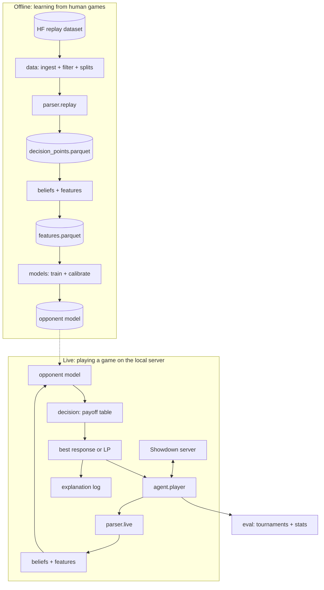

# Architecture

## Two paths through the same components

The system has an **offline path** (learning from recorded games) and a **live path** (playing
a game). They share the same state format, beliefs and features, so what the model learns
offline is exactly what it sees live.

## Data passed between modules

All shapes are defined in [`src/pokeagent/interfaces.py`](../src/pokeagent/interfaces.py).

| Produced by | Artifact | Consumed by |
|---|---|---|
| B | `data/interim/battles.parquet`: battle_id, upload_time, ratings, winner, log | C |
| B | `data/splits.json`: train / val / test battle ids | C, D, E |
| C | `data/processed/decision_points.parquet`: battle_id, turn, perspective, state (JSON of `PublicState`), action, won | D |
| C | `PublicState` from a live battle | D, F |
| D | `BeliefState` for any state | D (features), F |
| D | `data/processed/features.parquet`: ids, `FEATURE_NAMES` columns, action class label | E |
| E | `artifacts/opponent_model.pkl` and `OpponentModel.predict_proba` | F |
| F | `Decision` and explanation text | A (logs), demo |
| A | `reports/results/*.csv` | report |

## Key design decisions

The reasons behind these are viva questions. New decisions go in [decisions.md](decisions.md).

### 1. Public information only, for both sides

Replays are recorded from the spectator's view, so training data never contains a player's
unrevealed moves, even their own. If the live agent fed its full team knowledge into the model,
it would give the model inputs it never saw in training (a train/test mismatch). So every
`PublicState` holds only what a spectator could see. The decision engine may still use our full
team when playing, because it is not a learned model.

### 2. Split by battle, test on the newest battles

All turns from one battle go into the same split. Turns of the same game are highly correlated,
so splitting by turn would let the model "see" test games in training and inflate its scores.
The newest battles form the test set to check that the model generalises forward in time, as it
must when playing live.

### 3. Predict the type of action, not the exact move (version 1)

Every Pokémon has a different set of moves, so "which move" is a different classification
problem for each one. Version 1 predicts three classes (attack, non-damaging, switch), which is
learnable from the data and already useful to the decision engine. Predicting specific moves is
a version 2 extension.

### 4. One-turn payoffs (version 1)

The payoff of an (our action, their action) pair is estimated from the damage calculator over a
single turn, not by searching many turns ahead. This misses long-term plans (setting up, saving
a counter), which is a known limitation to report. A learned value model ("who is winning?") is
the version 2 fix.

### 5. Forced switches are excluded

After a faint, the replacement is not a simultaneous choice, so it does not fit the
predict-then-respond structure. Version 1 picks replacements with a simple rule.

### 6. A walking skeleton

`agent/player.py` already plays full games by choosing randomly. Each component replaces one
step, and the agent keeps working after every merge. There is never a "big bang" integration
at the end.

## Leakage checklist

Before any pull request that touches data, parser, features or models:

- [ ] The state for turn N uses only log lines before turn N's choices.
- [ ] No feature uses the action taken, the result of the turn, or who won.
- [ ] Splits come from `data/splits.json`; nothing is re-split.
- [ ] Scalers, encoders and calibrators are fitted on training (or validation) data only, never
      on test.
- [ ] Test-set numbers are computed once, at the end, not used to choose between models.
