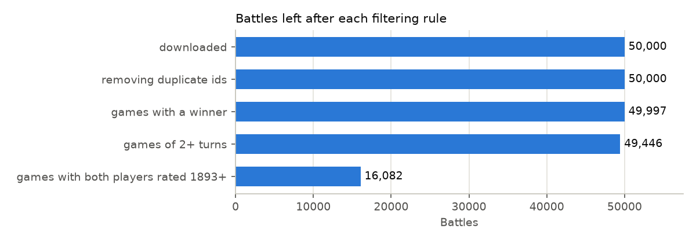
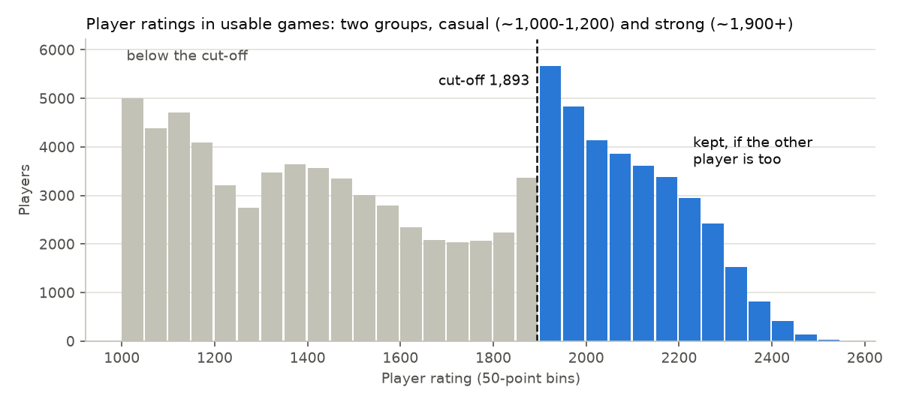
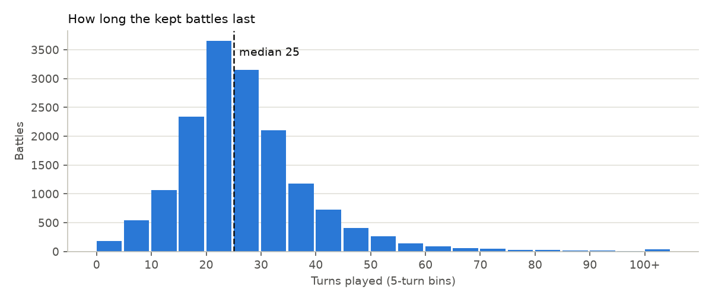

# Data report (role B)

What data the opponent model learns from, what we removed and why, and how it is split.
Every number here comes from `reports/results/data_summary.json`, written by the build
command below. The figures are drawn from that file by `python -m pokeagent.data.report`.

## How to reproduce

```bash
python -m pokeagent.data.build --max-battles 50000   # download, filter, split, summarise
python -m pokeagent.data.report                       # redraw the figures
```

- **Source:** `HolidayOugi/pokemon-showdown-replays` on Hugging Face, pinned to dataset revision
  `15a0a455dbcb7f5c07c2dd670f9252f275d4ddc8` (`config.HF_REPLAY_REVISION`). Licence not
  stated, so the data is used for this course only and never shared.
- **Scope:** the standard Gen 9 Random Battle files (`[Gen 9] RANDOMBATTLE_part1` to `_part11`),
  rows whose `formatid` is exactly `gen9randombattle`. That is **2,012,698 battles** in total.
  The separate Blitz file (a faster-timer variant) is left out.
- **Run:** 18 November 2026, on a laptop, with
  `python -m pokeagent.data.build --max-battles 50000` at commit `ef912a8` (the head of
  `b/b4-splits`), using `config.RATING_KEEP_FRACTION = 0.35`, `config.MIN_TURNS = 2` and the
  dataset revision above. Rebuilt on 20 November 2026 from `main`, whose data code is identical
  to `ef912a8`: every count below came out the same.

## What we downloaded

We took the **50,000 newest battles**, uploaded between **12 September and 5 October 2026**.
The newest games are the closest to the game our agent will actually play, because Showdown
updates the Random Battle sets from time to time. (The first rows of a file are a poor sample:
in the dataset check, the first 2,000 rows of part 1 all came from 18 to 20 July 2025.)

| Property | Value |
|---|---|
| Battles | 50,000 |
| Duplicate ids | 0 |
| Finished with a winner | 99.99% (3 games had none; no ties) |
| Both players rated | 92.9% |
| Turns per game | median 22; 10th percentile 9, 90th percentile 38; longest 226 |

## Filtering



| Rule | Battles left | Removed | Why |
|---|---|---|---|
| Downloaded | 50,000 | | |
| Remove duplicate ids | 50,000 | 0 | The same game twice would be counted twice, and could land in both train and test |
| Keep games with a winner | 49,997 | 3 | No clean ending to learn from |
| Keep games of 2+ turns | 49,446 | 551 | Mostly early forfeits; almost nothing to learn |
| Keep games with **both** players rated **1,893+** | **16,082** | 33,364 | Learn from competent play only (below) |

## The rating threshold



**How it was chosen.** The rule, fixed before looking at the data, is: aim to keep the top 35%
of usable, rated games, ranking each game by its *lower*-rated player (`config.RATING_KEEP_FRACTION`).
"Both players rated at least X" is the same as "the weaker player is rated at least X", so the
cut-off is the 65th percentile of the weaker player's rating. On this data that is **1,893**.
35% is a target, not an exact share: the percentile is rounded down and every game tied at the
cut-off is kept, so among rated games the kept share can come out slightly above 35%. The kept
share is 32.5% of all usable games because games with an unrated player (7%) are dropped before
the percentile is taken.

**What the distribution shows.** Ratings fall into two groups: a large group of casual players
near the 1,000 starting rating, and a second peak of strong players from about 1,900 upwards.
The cut-off lands at the start of the strong group, so the kept games are played between two
strong players (the weaker player's median rating is 2,062).

**Trade-off.** The opponent model learns how strong players behave. It may predict casual
players less well. We accept this because the agent should anticipate sensible play, and we
report it as a limitation.

## Game length of the kept battles



Kept games last a median of **25 turns** (10th percentile 14, 90th percentile 41), a little
longer than all downloaded games (median 22), possibly because strong players forfeit less
often. The last bar collects the 37 games of 100 turns or more.

**Class balance.** Player 1 wins 48.5% of kept games, close to 50%. This is a descriptive check
of the winner label only. It says nothing about leakage, and it does not show that the two
sides of the log reveal the same information; those are checked separately, by the parser's
public-state tests and the leakage checklist in
[docs/04-architecture.md](../docs/04-architecture.md).

## Train / validation / test split

Whole battles are split by upload time: the oldest 70% for training, the next 15% for
validation, the newest 15% for testing. No battle is in two sets (tested in
`tests/test_data.py`). The split is saved once in `data/splits.json`.

| Split | Battles | Uploaded |
|---|---|---|
| Train | 11,258 | 12 to 29 September 2026 |
| Validation | 2,412 | 29 September to 2 October 2026 |
| Test | 2,412 | 2 to 5 October 2026 |

Where a split starts on the same day the previous one ends, the boundary falls within that
day: every test battle is at least as new as every validation battle, and every validation
battle at least as new as every training battle.

**Why by battle:** turns of one game are nearly identical, so splitting a game across sets would
test the model on near-copies of its training rows. **Why by time:** the agent plays future
games, so the test set must be "the future"; validation sits in between, so tuning and
calibration are judged the same way. See [docs/decisions.md](../docs/decisions.md).

## Limitations

- **Three and a half weeks of games.** Enough for this project (16,082 battles), but a change to
  the Random Battle sets during that time would show up as a shift between train and test.
  The time-based split measures this instead of hiding it.
- **Strong players only** (above).
