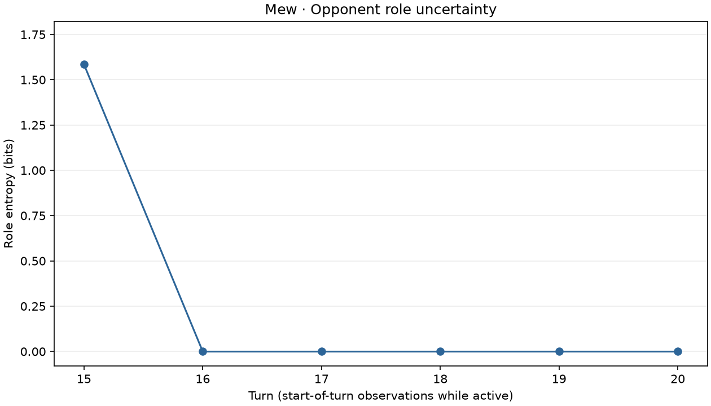

# Belief entropy in a local battle



In a local heuristics-vs-heuristics battle, Mew had three equally weighted roles at
the start of turn 15. It used Psychic Noise on that turn. Only one of the three
templates contained Psychic Noise, so role entropy was zero at the start of turn 16.
Mew remained active through turn 20.

The plot shows the largest first-to-last decrease among the eligible opponent traces
in eight local battles. It is an illustration selected after observing the sample.
For other Pokémon, different evidence can shift probability between roles and
increase entropy. Gaps in a trace indicate turns when the Pokémon was off the field.

Run from the repository root with the local Showdown server running:

```shell
python scripts/spikes/collect_local_games.py --games 8 --out data/interim/role_d_local_games.jsonl
python -m pokeagent.beliefs.plot_entropy --input data/interim/role_d_local_games.jsonl
```

The plotted game was `battle-gen9randombattle-4`, viewed from `p1` in the public
spectator log. It was recorded with Showdown revision
`7e743761cd13cdb361fc0f58eb5a866284894f5b` and belief tracker revision
`2d75823`. Showdown generates random teams, so rerunning the collection can produce
a different example.
