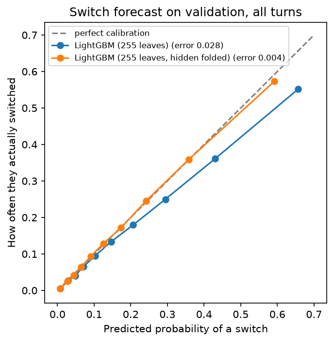
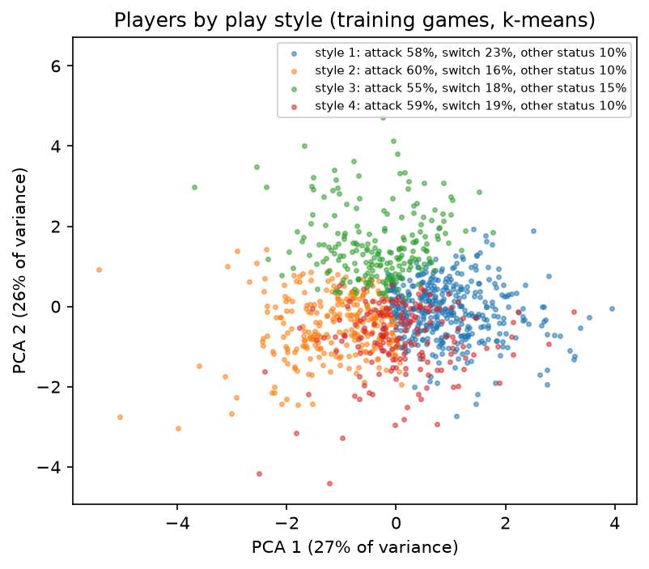

# An explainable agent for Pokémon Showdown Random Battles

BITS F464 Machine Learning, 2026-27 Semester 1. Team: see the [README](../README.md).

> **Draft.** Sections marked *pending* are filled in when the final runs finish: the headline
> evaluation (A7), the ablations (A6), the one-time test-set evaluation (E5) and the failure
> analysis (M7a). Every number here links to the script and result file it comes from.

## 1. The problem

Pokémon Showdown Random Battles (Generation 9, singles) is a two-player game with:

- **simultaneous moves**: both players choose at once, so there is often no single best move;
- **hidden information**: each side's team, items and moves are revealed only when used;
- **randomness**: damage rolls, accuracy, critical hits and random teams;
- a **huge mechanical space**: 18 types and hundreds of species, moves, items and abilities.

We build an agent that plays it and **explains every decision**. Each turn it:

1. tracks **beliefs** about the opponent's hidden set with Bayes' rule;
2. **forecasts** the opponent's next action type (attack, non-damaging move, switch) with a
   classifier trained on human games;
3. builds a **payoff table** (our options × their options), scored by the **change in predicted
   win probability** from a second model trained on human games;
4. chooses by **best response** to the forecast, or by a **minimax mixed strategy** (linear
   programming) that ignores the forecast;
5. writes an **explanation**: beliefs, forecast, every option's score and the choice.

## 2. Data

Details: [data_report.md](data_report.md). In short:

- 50,000 newest Gen 9 Random Battle replays (12 September to 5 October 2026) from a public
  Hugging Face dataset, pinned to one revision; used for this course only and never shared.
- Kept games with a winner, 2+ turns and **both players rated 1,893+** (the top 35% of rated
  games by the weaker player): **16,082 battles**.
- Split **by battle, newest last**: train 11,258, validation 2,412, test 2,412 battles, so no
  game appears in two splits and the test set is the most recent play.
- The parser turns each log into one **public start-of-turn state** per player per turn
  (765,596 decision points), holding only what a spectator could see.

## 3. The system

| Part | Module | What it does |
|---|---|---|
| Parser | `parser/` | Replay log or live battle → public state per turn, plus the action taken |
| Beliefs | `beliefs/` | Bayes' rule over each opponent Pokémon's possible Random Battle roles, from revealed moves, ability, item and tera type |
| Features | `features/` | 36 numbers per decision: HP, Pokémon left, boosts, status, hazards, type matchups, speed, and belief-based threats (expected status moves, hazard and setup chances) |
| Opponent model | `models/opponent.py` | LightGBM forecast of attack / non-damaging / switch, trained with a fourth "hidden" class |
| Value model | `models/value.py` | P(win) from a position: logistic regression and LightGBM on 44 features |
| Payoff table | `decision/` | Damage calculator, speed order, misses, protection, lasting effects (setup, status, hazards), drain, recoil, Substitute, end-of-turn HP; scored by change in P(win) |
| Strategy | `decision/strategies.py` | Best response to the forecast, or a minimax LP mixed strategy |
| Agent | `agent/` | poke-env player; per-turn explanation log; fallbacks recorded |
| Evaluation | `eval/` | Tournaments with Wilson intervals, ablations, puzzles, ladder play |

## 4. Key design choices

Every choice, with the alternatives and the evidence, is in [docs/decisions.md](../docs/decisions.md).
The ones that mattered most:

1. **Public information only, for both sides.** States hold what a spectator sees, so the same
   code reads replays (training) and live games (play) and nothing private leaks in.
2. **Three action classes instead of exact moves** for the main forecast: they exist for every
   Pokémon, so one model learns across all species. (Exact moves were added later, §5.4.)
3. **A "hidden" class for turns whose choice the log never shows** (10.4% of human turns: a
   Pokémon that faints before acting). Dropping them biased the switch forecast upward; with the
   extra class, predicted P(switch) is 17.3% against a true 17.1%, and the switch calibration
   error falls from 0.029 to 0.004, with no separate calibration step.
4. **Belief-based threat features (D7):** the forecast caught only 32% of non-damaging turns
   until the features said what the opponent could usefully do with a status move right now.
5. **Lasting effects valued by their effect on later turns (F8-F10):** a Swords Dance is worth
   the change in next turn's table, so it is worth a lot when safe and nothing when we are
   about to be knocked out.
6. **Payoffs in win probability (V4):** HP is not worth the same everywhere. A logistic value
   model, trained on human positions, converts each outcome's HP into a change in P(win).
7. **Model choice by validation log loss; the test split is read once, at the end.**

## 5. Results

### 5.1 Opponent model (validation)

All-turns log loss scores every turn: on a hidden turn we only know it was not a switch, so
the score is −log(1 − P(switch)). File: `reports/results/opponent_model_val.json`.

| Model | All-turns log loss | Accuracy | Macro-F1 | Mean P(switch) |
|---|---|---|---|---|
| uniform (1/3 each) | 1.099 | | | |
| naive class frequencies | 0.891 | 57.8% | 0.244 | 0.170 |
| logistic regression | 0.759 | 62.7% | 0.511 | 0.194 |
| LightGBM, visible turns only | 0.679 | 67.8% | 0.603 | 0.200 |
| **LightGBM with the hidden class** | **0.670** | 67.2% | 0.584 | 0.173 |

The true switch share is 0.171. The top features by gain are the expected number of status
moves in the opponent's set (13%), the opponent's HP (13%) and the speed comparison (8%).


*Test set (E5): pending, evaluated once with the models fixed.*

### 5.2 Deep learning comparison (validation)

| Model | All-turns log loss |
|---|---|
| MLP on the same 36 features | 0.681 |
| GRU over the whole game, no memory (ablation) | 0.687 |
| GRU over the whole game | 0.677 |
| LightGBM (chosen) | 0.670 |

The game history carries real signal (memory is worth 0.0095), but boosted trees on the
per-turn features remain best. Files: `dl_mlp_val.json`, `dl_sequence_val.json`.

### 5.3 Value model (validation)

| Model | Log loss | AUC |
|---|---|---|
| coin flip | 0.693 | |
| team HP lead only | 0.626 | 0.701 |
| logistic regression (used in the payoff table) | 0.590 | 0.743 |
| LightGBM | 0.581 | 0.750 |

The first five turns are close to a coin flip (random, unseen teams); by turn 31+ log loss is
0.48. One Pokémon of team-HP lead moves P(win) from 52% to 72% at an even position.

### 5.4 Exact move and play styles (validation)

Exact move (which move, given that they use one): LightGBM on (position, candidate move)
pairs reaches **51% top-1 and 87% top-3**, against 31% and 72% for the belief prior.

Play styles: on 1,058 players, k-means and a Gaussian mixture agree on four soft groups
(switchers, setup sweepers, status/Protect users, hazard setters), but styles form a
continuum (silhouette 0.18), and adding a player's style to the forecast made it worse
(it acted as a player fingerprint).


### 5.5 Games

Development history, best response against `SimpleHeuristicsPlayer`, 1,000 games each
(Wilson 95% intervals). Each step is compared with the same code without the change:

| Step | Wins | Same code without it |
|---|---|---|
| Flat forecast, no beliefs | 617 | |
| LightGBM forecast (29 features) | 632 | 606 (beliefs, flat forecast) |
| + belief threat features (D7) | 641 | |
| + lasting effects (F8-F10) | 670 | 606 (effects off), p = 0.003 |
| + drain, Substitute, end-of-turn (F11) | 650 | 670, within noise |
| **+ payoffs in win probability (V4)** | **751** | 674 (HP utility), p = 0.0001 |

*Headline evaluation (A7), both strategies against random, max power and the heuristics bot:
pending.* *Ablations (A6), one component off at a time: pending.*

### 5.6 Puzzles

Twelve hand-built positions with agreed answers ([puzzles.py](../src/pokeagent/eval/puzzles.py)).
Best response solves **11/12** (9/12 with a flat forecast); minimax puts 82% of its
probability on accepted answers. The miss, Stealth Rock on turn 1, is fixed by a data-based
hazard weight (pending its game check). The puzzles found a real bug: Moonlight, Synthesis,
Shore Up, Rest and Strength Sap healed nothing in the table.

### 5.7 Ladder

*Pending: games against people on the public ladder (A8).*

## 6. Failure analysis

*Pending (M7a): at least 10 lost games, read with their explanation logs, sorted by cause.*

## 7. Limitations

- **One turn deep.** Lasting effects look one turn ahead from the current HP; there is no
  multi-turn search.
- **The opponent's switch-in is often unseen**, so an attack into a predicted switch gets no
  damage credit. This makes minimax cautious.
- **Forced replacements are still scored by HP**, not by the value model.
- **Approximate mechanics:** two damage endpoints, no chance-based secondary effects, no
  switch-in abilities, no new tera choices, an existing Substitute assumed full.
- **Evaluation mostly against a bot.** The heuristics bot is fast and repeatable but is not a
  human; ladder games are the real test.

## 8. Reproducing

See the README and [docs/07-setup.md](../docs/07-setup.md). The main commands:

```bash
python -m pokeagent.data.build --max-battles 50000      # data (B)
python -m pokeagent.parser.export                       # decision points (C)
python -m pokeagent.features.export                     # opponent features (D)
python -m pokeagent.models.train                        # opponent models (E)
python -m pokeagent.features.value && python -m pokeagent.models.train_value   # value model
python scripts/run_puzzles.py
python scripts/run_ablations.py --all --games 1000
python scripts/run_headline.py --all --games 1000
```
